<div align="center">

<picture>
  <source media="(prefers-color-scheme: dark)" srcset="docs/hero-dark.svg">
  <source media="(prefers-color-scheme: light)" srcset="docs/hero-light.svg">
  
</picture>

# stackdraw

**Animated architecture and system design diagrams with official AWS, Azure, Google Cloud, Kubernetes, GitHub and IBM icons.**<br>
One YAML spec in; SVG, PNG, editable draw.io, a React component and an HTML viewer out.

[](https://github.com/Sagargupta16/stackdraw/actions/workflows/ci.yml)


</div>

The diagram above is [docs/hero.yaml](docs/hero.yaml): 40 lines of YAML, laid out and rendered by stackdraw. It moves because every SVG is animated by default: a packet travels each edge, and the numbered steps play in order, on a loop. GitHub keeps the animation; the PNG of the same spec is a still frame.

## What you get

- **Official, current icons only.** 16,682 icons: AWS (810), Azure (636), Google Cloud (233), Kubernetes (40), GitHub Octicons (399) and IBM Carbon (2,776), plus 5,502 tech logos and 6,286 neutral symbols for system design. The cloud packs are rebuilt from each vendor's own download, pinned by checksum. Google Cloud products get the icon Google's 2026 guide assigns them; deprecated sets and unofficial redraws of cloud icons are left out.
- **Official conventions.** AWS groups follow the AWS Architecture Icons deck (borders, dashes, corner tiles, label placement, open arrowheads, numbered callouts); Google Cloud and Azure groups are measured from their own reference diagrams. Every value cites its source in [styles.md](skills/stackdraw/references/styles.md).
- **Automatic layout.** The Eclipse Layout Kernel places nested boundaries, routes edges at right angles, joins fan-in and fan-out into trunks and keeps the order you wrote unless that would cross edges. No coordinates to write.
- **Diagrams that move.** Animated SVG by default: packets travel every edge at one speed, numbered steps play as a story, line styles stay as drawn. `animate: flow` for marching dashes, `--static` for a still file.
- **Five outputs from one spec.** SVG for READMEs and docs, PNG for slides and chat (3x by default, sharp when zoomed), `.drawio` you can keep editing, a TSX component for React sites, and a standalone HTML viewer with dark mode, pan and pinch zoom.
- **Made for agents.** A skill with a fast path and authoring rules, a JSON Schema, 392 short aliases (`aws:s3`, `azure:aks`, `k8s:deploy`), ranked icon search, and a validator whose every finding names the subject and the fix.
- **No install.** The CLI, layout engine, PNG renderer, fonts and the official cloud packs ship in the skill folder (9 MB). Logo and glyph sets are not copied in: they load from their own npm libraries the first time a diagram uses them, verified by checksum and cached. Node.js 22 or newer is all it needs.

## Install

Claude Code plugin:

```
/plugin marketplace add Sagargupta16/stackdraw
/plugin install stackdraw@stackdraw
```

Any agent that reads [Agent Skills](https://agentskills.io) (Codex, Cursor, Gemini CLI, Kiro and others):

```bash
npx skills add Sagargupta16/stackdraw
```

Only the CLI:

```bash
git clone https://github.com/Sagargupta16/stackdraw
node stackdraw/skills/stackdraw/scripts/stackdraw.mjs doctor
```

## Quick start

Ask your agent for a diagram ("draw the architecture of this repo", "a three-tier web app on AWS across two Availability Zones", "turn this Mermaid flowchart into a Google Cloud diagram"). It writes a spec, validates it, renders it and checks the picture. Or write one yourself:

```yaml
title: Orders API
direction: right
groups:
  cloud:  { type: aws:cloud }
  region: { type: aws:region, label: eu-west-1, in: cloud }
nodes:
  users: { icon: aws:users, label: Customers }
  api:   { icon: aws:api-gateway, in: region }
  fn:    { icon: aws:lambda, label: Create order, in: region }
  table: { icon: aws:dynamodb, label: Orders, in: region }
edges:
  - users -> api: HTTPS
  - api -> fn -> table
```

```bash
node skills/stackdraw/scripts/stackdraw.mjs render orders.yaml -f svg,png
```

Labels default to the official service names, so `{ icon: aws:lambda }` reads "AWS Lambda". Edges use arrows: `->` solid, `-->` dashed, `..>` dotted, `==>` thick, `<->` both ways, `a -> b, c` to fan out. The full format is in [spec.md](skills/stackdraw/references/spec.md).

## Gallery

Every picture below is the animated SVG rendered from a spec in [skills/stackdraw/examples](skills/stackdraw/examples), checked against the renderer by CI; `stackdraw init <name>` copies any of them as a starting point. All 27, with commands, in [examples/README.md](examples/README.md).

[`modern-web-stack`](skills/stackdraw/examples/modern-web-stack.yaml): Cloudflare, Next.js on Vercel, Neon, Upstash, Stripe, Clerk, Resend, Sentry and PostHog, drawn as cards

<a href="examples/modern-web-stack.svg"></a>

[`gitops-kubernetes`](skills/stackdraw/examples/gitops-kubernetes.yaml): GitHub Actions and Argo CD with the official Kubernetes icons, numbered steps from pull request to production

<a href="examples/gitops-kubernetes.svg"></a>

[`gcp-gke-platform`](skills/stackdraw/examples/gcp-gke-platform.yaml): Google Cloud's own frames and 2026 product icons around a GKE cluster and its delivery pipeline

<a href="examples/gcp-gke-platform.svg"></a>

[`azure-hub-spoke`](skills/stackdraw/examples/azure-hub-spoke.yaml): an Azure hub-spoke network with ExpressRoute, a VPN backup, Azure Firewall, Bastion and private endpoints

<a href="examples/azure-hub-spoke.svg"></a>

[`data-platform-oss`](skills/stackdraw/examples/data-platform-oss.yaml): an open-source lakehouse from change data capture to dashboards

<a href="examples/data-platform-oss.svg"></a>

[`rag-open-source`](skills/stackdraw/examples/rag-open-source.yaml): RAG with open components: an ingestion lane and a query lane meeting at Qdrant

<a href="examples/rag-open-source.svg"></a>

[`multi-cloud`](skills/stackdraw/examples/multi-cloud.yaml): each vendor's own group style side by side, joined at a colocation router

<a href="examples/multi-cloud.svg"></a>

[`system-design-url-shortener`](skills/stackdraw/examples/system-design-url-shortener.yaml): vendor-neutral system design with product logos

<a href="examples/system-design-url-shortener.svg"></a>

[`aws-three-tier`](skills/stackdraw/examples/aws-three-tier.yaml): VPC, two Availability Zones, public, web and data subnets, an Auto Scaling group drawn across both zones

<a href="examples/aws-three-tier.svg"></a>

[`c4-container`](skills/stackdraw/examples/c4-container.yaml): a C4 container view built from shapes

<a href="examples/c4-container.svg"></a>

## How it works

<picture>
  <source media="(prefers-color-scheme: dark)" srcset="docs/how-it-works-dark.svg">
  
</picture>

## Validation that tells you the fix

```text
$ stackdraw validate orders.yaml
error DG101 node "fn" uses unknown icon "aws:lamda" {"node":"fn","icon":"aws:lamda"}
      fix: use icon "aws:lambda"
      fix: run `stackdraw icons search lamda`
error DG108 unknown key "lable" in node "db" {"where":"node \"db\"","key":"lable"}
      fix: rename "lable" to "label"
failed: 2 error(s), 0 warning(s)
```

Spec errors (DG1xx) stop the render; composition warnings (DG2xx: an edge through a node, colliding labels, a diagram too wide to read) keep it going unless `--strict` is set. `render --json` writes every file atomically and prints a receipt with the size and SHA-256 of each output.

## A review board that measures before it judges

`stackdraw review` looks at the diagram at the width readers see it (880 px for a README column) and scores six dimensions: official conventions, layout, grid, arrows and flow, overlap, and size and quality.

```text
$ git show v0.2.1:skills/stackdraw/examples/gitops-kubernetes.yaml > gitops-0.2.yaml
$ stackdraw review gitops-0.2.yaml --width 880
review gitops-0.2: 1964x786 in a 880px column, seen at 880x352 (scale 0.45, light)
score 85.3/100  FAIL (pass = no blocker or major and score >= 85)
...
blocker quality.label-size node labels render at 5.82px at this width (1964px canvas shown at 0.45x)
        fix: use direction: down so the diagram is narrower
```

The review loop took that diagram to 98.5 and passing: it now runs top to bottom, so its labels show at full size in the README column.

In Claude Code, `/stackdraw:review <spec>` runs the full loop. Code measures everything that can be counted: overlaps, crossings, alignment, text size and contrast at display width. Three read-only agents run in parallel and judge what cannot be counted:

- `conventions-reviewer` checks the vendor's own rules, quoted from the AWS deck, Azure Well-Architected, Google's icon guide and the C4 notation.
- `flow-reviewer` checks the story the arrows tell.
- `legibility-reviewer` reads the PNG at display size.

A finding counts only if it cites a measured value or a vendor rule. Each round applies one to three spec patches, and a round is kept only when the score goes up and no hard count does; the loop stops after three rounds or two without progress. Vision models are weak at counting overlaps and intersections, so they never decide those. The rubrics live in [references/review](skills/stackdraw/references/review/loop.md), so the same passes run inline anywhere the skill is installed without subagents.

## Commands

| Command | Does |
| --- | --- |
| `render <spec> [-o base] [-f svg,png,drawio,tsx,html\|all] [--theme light\|dark\|both] [--animate packets\|flow\|none] [--static]` | Validate, lay out, render. |
| `validate <spec> [--strict] [--json]` | Spec errors and composition warnings, each with fixes. |
| `review <spec> [--width 880] [--theme light\|dark] [--strict] [--json]` | Score the diagram at the width readers see it; writes `<base>.review.json` and a PNG at that width. |
| `icons search <words> [--pack aws]` | Ranked icon ids with official names. |
| `icons show <id>`, `icons list`, `icons packs` | Browse the catalog and its sources. |
| `icons fetch` | Download and cache the logo and glyph libraries for offline renders. |
| `styles` | Every group type and node shape. |
| `init [template]` | Start from one of the examples. |
| `import mermaid <flowchart.mmd>` | Turn an existing Mermaid flowchart into a spec, with official icons where the labels name real products. |
| `doctor`, `demo` | Check the install; render every example. |

## Icon packs

| Pack | Icons | Source | Ships |
| --- | ---: | --- | --- |
| `aws` | 810 | [AWS Architecture Icons](https://aws.amazon.com/architecture/icons/), 2026-07-31 package | bundled |
| `azure` | 636 | [Azure Architecture Icons](https://learn.microsoft.com/en-us/azure/architecture/icons/) V24 | bundled |
| `gcp` | 233 | [Google Cloud icons](https://cloud.google.com/icons), core and category icons mapped to products as in Google's May 2026 guide | bundled |
| `k8s` | 40 | [Kubernetes community icons](https://github.com/kubernetes/community/tree/master/icons) | bundled |
| `github` | 399 | [GitHub Octicons](https://primer.style/octicons) | npm `@primer/octicons` |
| `ibm` | 2,776 | [IBM Carbon icons](https://carbondesignsystem.com/elements/icons/library/), IBM's diagram node icons and product glyphs | npm `@iconify-json/carbon` |
| `logos` | 2,151 | [SVG Logos](https://github.com/gilbarbara/logos) | npm `@iconify-json/logos` |
| `si` | 3,351 | [Simple Icons](https://simpleicons.org) | npm `@iconify-json/simple-icons` |
| `tabler` | 6,286 | [Tabler Icons](https://tabler.io/icons) | npm `@iconify-json/tabler` |

Bundled packs exist only as vendor downloads, so they ship with the skill and work offline. The npm sets load at render time from a local `node_modules`, the user cache or jsDelivr, checked against a pinned SHA-256; `stackdraw icons fetch` caches them ahead of time, and [icons.md](skills/stackdraw/references/icons.md#where-icons-load-from) has the details. A monthly workflow checks the vendors' pages for new releases and opens a PR with the updated packs. Icons, logos and trademarks belong to their owners and are used under the terms listed in [THIRD_PARTY_NOTICES.md](THIRD_PARTY_NOTICES.md); the AWS, Microsoft and Google terms allow them in architecture diagrams.

## Development

```bash
pnpm install
pnpm lint
pnpm typecheck
pnpm test
pnpm build                       # src/ -> skills/stackdraw/scripts/stackdraw.mjs
pnpm gallery                     # re-render examples/ and docs/
node scripts/check-repo.mjs      # dashes, links, counts, doc snippets, gallery freshness
pnpm sync-icons                  # rebuild icon catalogs (--latest re-pins new vendor releases)
```

See [CONTRIBUTING.md](CONTRIBUTING.md) for how the pieces fit and [SECURITY.md](SECURITY.md) for reporting issues.

## License

Code and docs: [MIT](LICENSE). Icons, fonts and the vendored engines keep their own licenses: [THIRD_PARTY_NOTICES.md](THIRD_PARTY_NOTICES.md).
