# Example gallery

Twenty-six diagrams, each rendered from one spec in [skills/stackdraw/examples](../skills/stackdraw/examples). Every spec doubles as a template: `stackdraw init <name>` copies it to `diagram.yaml`, and `stackdraw init --list` prints the names. The previews are the SVGs themselves, so they stay sharp at any zoom and show the motion; every spec also renders a still PNG next to it.

Run the commands from the repository root; `stackdraw` stands for `node skills/stackdraw/scripts/stackdraw.mjs`. `pnpm gallery` re-renders every picture here, and `node scripts/gallery.mjs --check` (run by CI) fails when a committed picture no longer matches its spec.

[`modern-web-stack`](../skills/stackdraw/examples/modern-web-stack.yaml): a SaaS web stack drawn as cards: Next.js on Vercel serving the UI, Cloudflare in front of the Node.js API, Neon and Upstash for data, Stripe, Resend and Clerk as third-party services, Sentry and PostHog for observability.

`stackdraw render skills/stackdraw/examples/modern-web-stack.yaml -o examples/modern-web-stack -f svg,png`

[`data-platform-oss`](../skills/stackdraw/examples/data-platform-oss.yaml): an open-source lakehouse: Debezium and Airbyte feed Kafka, Flink lands Iceberg tables on Ceph with a Hive Metastore catalog, dbt models them on Trino for Superset, on an Airflow schedule.

`stackdraw render skills/stackdraw/examples/data-platform-oss.yaml -o examples/data-platform-oss -f svg,png`

[`rag-open-source`](../skills/stackdraw/examples/rag-open-source.yaml): RAG with open components: an ingestion lane chunks and embeds documents into Qdrant, and a React, FastAPI and LangChain query lane answers with a local Ollama model or a hosted one, traced in Langfuse.

`stackdraw render skills/stackdraw/examples/rag-open-source.yaml -o examples/rag-open-source -f svg,png`

[`system-design-url-shortener`](../skills/stackdraw/examples/system-design-url-shortener.yaml): vendor-neutral `generic:` icons and product logos, from CDN, load balancer and API servers to Redis, PostgreSQL and a Kafka, Flink and ClickHouse click pipeline.

`stackdraw render skills/stackdraw/examples/system-design-url-shortener.yaml -o examples/system-design-url-shortener -f svg,png`

[`gitops-kubernetes`](../skills/stackdraw/examples/gitops-kubernetes.yaml): GitOps with Argo CD: a pull request runs GitHub Actions, which pushes the image to ghcr.io and bumps its tag in the config repository; Argo CD syncs the staging cluster automatically and production on a manual sync, with Prometheus and Grafana monitoring production.

`stackdraw render skills/stackdraw/examples/gitops-kubernetes.yaml -o examples/gitops-kubernetes -f svg,png`

[`k8s-workload`](../skills/stackdraw/examples/k8s-workload.yaml): the official Kubernetes icons inside a namespace: Ingress, Service, Deployment, ReplicaSet, Pods, HorizontalPodAutoscaler, ConfigMap, Secret and a PersistentVolumeClaim bound to a PersistentVolume.

<a href="k8s-workload.svg"></a>

`stackdraw render skills/stackdraw/examples/k8s-workload.yaml -o examples/k8s-workload -f svg,png`

[`gcp-gke-platform`](../skills/stackdraw/examples/gcp-gke-platform.yaml): a GKE platform in Google Cloud's frames (cloud, project, region, cluster): Cloud Build pushes each image to Artifact Registry and releases it through Cloud Deploy to two namespaces, next to Memorystore, Secret Manager and Cloud SQL, with Cloud Logging and Cloud Monitoring.

`stackdraw render skills/stackdraw/examples/gcp-gke-platform.yaml -o examples/gcp-gke-platform -f svg,png`

[`gcp-web-app`](../skills/stackdraw/examples/gcp-web-app.yaml): Google Cloud product cards (`look: card`), a global load balancer in front of Cloud Run with Cloud CDN and Cloud Armor attached to its backend, and Cloud Run reaching Cloud SQL, Secret Manager and Memorystore (in a VPC network, over Direct VPC egress).

<a href="gcp-web-app.svg"></a>

`stackdraw render skills/stackdraw/examples/gcp-web-app.yaml -o examples/gcp-web-app -f svg,png`

[`gcp-streaming-analytics`](../skills/stackdraw/examples/gcp-streaming-analytics.yaml): Pub/Sub and Dataflow stream events into BigQuery and Cloud Storage and score them with a Vertex AI model, with Looker dashboards on BigQuery.

<a href="gcp-streaming-analytics.svg"></a>

`stackdraw render skills/stackdraw/examples/gcp-streaming-analytics.yaml -o examples/gcp-streaming-analytics -f svg,png`

[`azure-hub-spoke`](../skills/stackdraw/examples/azure-hub-spoke.yaml): a hub-spoke network on Azure: on-premises reaches the hub's ExpressRoute and VPN gateways and Azure Firewall, which forwards over the peerings to the spokes, with Bastion in the hub, AKS in one spoke and VMs with a private endpoint to Azure SQL in the other, Private DNS and Log Analytics.

`stackdraw render skills/stackdraw/examples/azure-hub-spoke.yaml -o examples/azure-hub-spoke -f svg,png`

[`azure-web-app`](../skills/stackdraw/examples/azure-web-app.yaml): Front Door to App Service outside the VNet, with only its integration interface in the app subnet, reaching Azure SQL and Key Vault through private endpoints and Private DNS zones, with Azure's filled arrowheads.

<a href="azure-web-app.svg"></a>

`stackdraw render skills/stackdraw/examples/azure-web-app.yaml -o examples/azure-web-app -f svg,png`

[`azure-aks-platform`](../skills/stackdraw/examples/azure-aks-platform.yaml): Application Gateway in front of an AKS cluster with system and user node pools, Container Registry, workload identity (the pods exchange their token with Microsoft Entra ID, then read Key Vault), and Log Analytics.

<a href="azure-aks-platform.svg"></a>

`stackdraw render skills/stackdraw/examples/azure-aks-platform.yaml -o examples/azure-aks-platform -f svg,png`

[`multi-cloud`](../skills/stackdraw/examples/multi-cloud.yaml): AWS, Google Cloud and Azure in their own vendor frames (the Azure subscription inside its Microsoft Entra tenant), federated to one Okta tenant and joined at a colocation router by Direct Connect, Partner Interconnect and ExpressRoute, each reaching its workload through a gateway or router in a VPC or VNet.

`stackdraw render skills/stackdraw/examples/multi-cloud.yaml -o examples/multi-cloud -f svg,png`

[`observability-stack`](../skills/stackdraw/examples/observability-stack.yaml): OpenTelemetry SDKs export to a Collector that fans out to Prometheus, Loki and Tempo, with Grafana querying them and Alertmanager routing to Slack and paging PagerDuty.

<a href="observability-stack.svg"></a>

`stackdraw render skills/stackdraw/examples/observability-stack.yaml -o examples/observability-stack -f svg,png`

[`system-design-chat`](../skills/stackdraw/examples/system-design-chat.yaml): shape nodes for a whiteboard look (cylinders for stores, a queue for the Kafka topic) around WebSocket gateways, chat, presence and push services, media storage and a CDN.

<a href="system-design-chat.svg"></a>

`stackdraw render skills/stackdraw/examples/system-design-chat.yaml -o examples/system-design-chat -f svg,png`

[`c4-container`](../skills/stackdraw/examples/c4-container.yaml): a C4 container view built from shapes: two people, a `c4:boundary` system, its containers and database, and grey external systems.

`stackdraw render skills/stackdraw/examples/c4-container.yaml -o examples/c4-container -f svg,png`

[`starter`](../skills/stackdraw/examples/starter.yaml): the `stackdraw init` default, a load-balanced container service with its database and cache in a VPC and a bucket in the Region, inside one AWS Cloud group.

<a href="starter.svg"></a>

`stackdraw render skills/stackdraw/examples/starter.yaml -o examples/starter -f svg,png`

[`aws-serverless-api`](../skills/stackdraw/examples/aws-serverless-api.yaml): CloudFront (a global service, so drawn outside the Region) serves a single-page app from S3 and sends `/api/*` to an API Gateway REST API, Lambda and DynamoDB, with a Cognito user pool authorizer; the function also writes to a receipts bucket.

`stackdraw render skills/stackdraw/examples/aws-serverless-api.yaml -o examples/aws-serverless-api -f svg,png`

[`aws-three-tier`](../skills/stackdraw/examples/aws-three-tier.yaml): a VPC across two Availability Zones with public, web and data subnets, NAT gateways, an ALB, and one Auto Scaling group drawn across both zones with `around:`; zone B writes to the primary database in zone A.

`stackdraw render skills/stackdraw/examples/aws-three-tier.yaml -o examples/aws-three-tier -f svg,png`

[`aws-three-tier-dark`](../skills/stackdraw/examples/aws-three-tier-dark.yaml): the same diagram with `theme: dark`.

<a href="aws-three-tier-dark.svg"></a>

`stackdraw render skills/stackdraw/examples/aws-three-tier-dark.yaml -o examples/aws-three-tier-dark -f svg,png --theme dark`

[`aws-event-driven`](../skills/stackdraw/examples/aws-event-driven.yaml): an EventBridge bus fans orders out to a Step Functions workflow, an SQS billing queue and an SNS topic, with numbered `step:` edges on the main path.

<a href="aws-event-driven.svg"></a>

`stackdraw render skills/stackdraw/examples/aws-event-driven.yaml -o examples/aws-event-driven -f svg,png`

[`aws-data-lake`](../skills/stackdraw/examples/aws-data-lake.yaml): Firehose and DMS land data in raw, curated and analytics zones refined by Glue jobs, with the catalog and Lake Formation beside the zones and Athena, Redshift and Quick Sight at the bottom.

<a href="aws-data-lake.svg"></a>

`stackdraw render skills/stackdraw/examples/aws-data-lake.yaml -o examples/aws-data-lake -f svg,png`

[`aws-genai-rag`](../skills/stackdraw/examples/aws-genai-rag.yaml): an ingestion lane (S3, Lambda) and a query lane (Cognito, API Gateway, a Bedrock AgentCore agent) meet at shared services: a Titan Text Embeddings V2 model that embeds both the chunks and the question, a Bedrock text model, and an OpenSearch Serverless vector index.

<a href="aws-genai-rag.svg"></a>

`stackdraw render skills/stackdraw/examples/aws-genai-rag.yaml -o examples/aws-genai-rag -f svg,png`

[`aws-hybrid-network`](../skills/stackdraw/examples/aws-hybrid-network.yaml): a corporate data center reaches VPCs in three AWS accounts in us-east-1 through a Transit Gateway, over Direct Connect with a Site-to-Site VPN backup.

<a href="aws-hybrid-network.svg">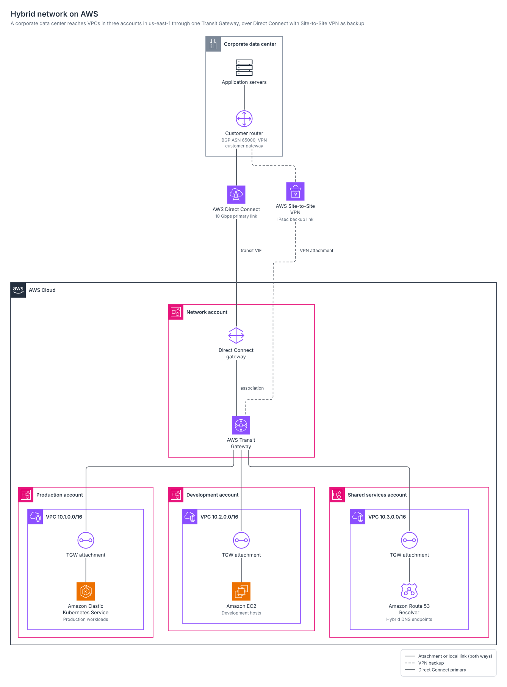</a>

`stackdraw render skills/stackdraw/examples/aws-hybrid-network.yaml -o examples/aws-hybrid-network -f svg,png`

[`aws-hybrid-landing-zone`](../skills/stackdraw/examples/aws-hybrid-landing-zone.yaml): an AWS landing zone with AWS Organizations OUs for security, infrastructure and workloads, IAM Identity Center federated to a corporate IdP, central logging and threat detection, Network Firewall inspection, and a data center on Direct Connect with VPN backup reaching two Regions through peered Transit Gateways.

<a href="aws-hybrid-landing-zone.svg"></a>

`stackdraw render skills/stackdraw/examples/aws-hybrid-landing-zone.yaml -o examples/aws-hybrid-landing-zone -f svg,png`

[`ml-platform`](../skills/stackdraw/examples/ml-platform.yaml): SageMaker AI Processing into Feature Store, a Step Functions training pipeline, Model Registry, batch and real-time serving, and a drift alarm that starts retraining.

<a href="ml-platform.svg"></a>

`stackdraw render skills/stackdraw/examples/ml-platform.yaml -o examples/ml-platform -f svg,png`

[`github-actions-cicd`](../skills/stackdraw/examples/github-actions-cicd.yaml): a merge to main runs GitHub Actions, which assumes an IAM role with its OIDC token, then pushes to ECR and deploys to ECS with CloudFormation.

<a href="github-actions-cicd.svg"></a>

`stackdraw render skills/stackdraw/examples/github-actions-cicd.yaml -o examples/github-actions-cicd -f svg,png`
